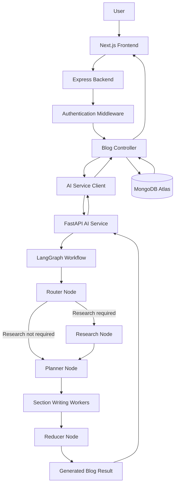
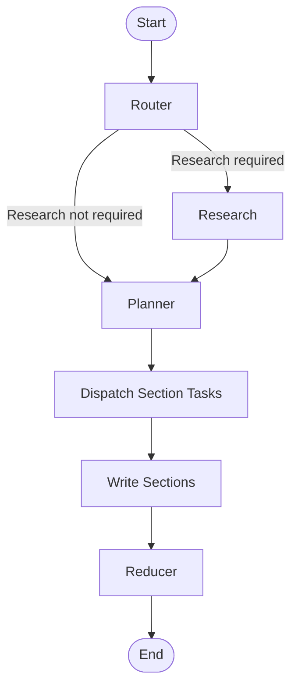

# BlogPilot — AI-Powered Blog Writing Agent

BlogPilot is an AI-powered blog-writing application that helps users transform a simple topic or prompt into a structured blog post. It uses an agentic workflow to determine whether research is needed, create a blog plan, generate individual sections, and combine them into a complete article.

The project follows a **three-service architecture** consisting of a Next.js frontend, a Node.js and Express backend, and a Python-based AI service built with FastAPI and LangGraph.

The primary goal is to build a modular AI writing system in which application logic, data persistence, authentication, and AI orchestration remain separated and independently maintainable.

## Live Demo

- **Frontend:** https://blogpilot-bice.vercel.app
- **Backend:** https://blogpilot-pjxd.onrender.com
- **AI Service:** https://blogpilot-ai-service.onrender.com

*Note: The services are deployed independently. Availability of the complete blog-generation workflow depends on the configuration and health of all three services.*

## Table of Contents

- [Features](#features)
- [Architecture](#architecture)
- [How BlogPilot Works](#how-blogpilot-works)
- [AI Agent Workflow](#ai-agent-workflow)
- [Technology Stack](#technology-stack)
- [Project Structure](#project-structure)
- [Authentication and User Management](#authentication-and-user-management)
- [API Overview](#api-overview)
- [Environment Configuration](#environment-configuration)
- [Local Setup](#local-setup)
- [Running the Application](#running-the-application)
- [Deployment](#deployment)
- [Current Status](#current-status)
- [Future Improvements](#future-improvements)
- [Contributing](#contributing)
- [License](#license)

## Features

### AI-Powered Blog Generation

- Generate blog content from a user-provided topic or prompt.
- Use a structured planning stage before writing the article.
- Generate individual blog sections through separate graph tasks.
- Combine generated sections into a final blog result.
- Return structured output containing blog content, planning information, sources, and image metadata where available.

### Agentic Workflow with LangGraph

- Route the workflow according to whether research is required.
- Execute research before planning when necessary.
- Create a structured plan with multiple sections.
- Dispatch section-writing tasks using LangGraph's `Send` mechanism.
- Reduce individual section outputs into a consolidated result.

### Research Integration

The AI service includes a research node and a Tavily integration dependency. Research is performed when the router determines that it is needed and the configured research workflow is available.

### User Authentication

The Express backend provides endpoints for registration, login, access-token refresh, logout, and password recovery using email OTP verification.

### Profile Management

- Retrieve the authenticated user's profile.
- Update profile information.
- Upload and replace profile avatars using Cloudinary.

### Persistent Data

MongoDB Atlas and Mongoose are used for application data and saved blog records.

### Independent Services

The frontend, backend, and AI service can be developed and deployed separately, allowing each layer to evolve without combining all responsibilities into one application.

## Architecture

BlogPilot uses three primary application services.

| Service | Technology | Responsibility |
|---|---|---|
| Frontend | Next.js, React, Tailwind CSS | User interface and API communication |
| Backend | Node.js, Express, Mongoose | Authentication, API endpoints, application logic, and persistence |
| AI service | Python, FastAPI, LangGraph | Blog-generation orchestration and AI execution |
| Database | MongoDB Atlas | Persistent application and blog data |
| Language models | LangChain integrations, Groq and Google GenAI packages | Model access, depending on the configured workflow |
| Research | Tavily | External information retrieval when invoked |
| Image storage | Cloudinary | User avatar storage |
| Frontend hosting | Vercel | Production frontend |
| Backend hosting | Render | Express API and AI service |

### Architecture Diagram



The diagram represents the intended request and generation flow. Exact model providers, tool calls, and persistence behavior depend on the current implementation and configuration.

## How BlogPilot Works

The application processes a blog-generation request through the following sequence:

1. The user signs in and enters a blog topic or prompt.
2. The frontend sends the request to the Express backend.
3. The backend applies the relevant authentication and request-handling logic.
4. The backend calls the FastAPI AI service.
5. The LangGraph workflow determines whether research is required.
6. The workflow researches the topic when needed and creates a structured plan.
7. Section-writing workers generate content for the planned sections.
8. A reducer combines the section outputs into a consolidated blog result.
9. The AI service returns the result to Express.
10. The backend saves the generated blog and returns the response to the frontend.

## AI Agent Workflow

The core AI workflow is defined in `ai-service/app/agent/graph.py`.

It uses LangGraph's `StateGraph`, conditional edges, and `Send` to control execution and dispatch section-writing tasks.

### Workflow Nodes

| Node | Responsibility |
|---|---|
| `router_node` | Determines whether the topic requires research |
| `research_node` | Collects research evidence when required |
| `planner_node` | Creates a structured blog plan |
| `write_section_node` | Generates content for an individual planned section |
| `reducer_node` | Combines the generated section outputs |

### Workflow Execution

**1. Router**

The graph begins at the router node.

```python
builder.add_edge(START, "router")
```

The routing function checks `needs_research`:

- If research is required, execution moves to `research`.
- Otherwise, execution moves directly to `planner`.

**2. Research**

When required, the research node gathers evidence. The graph then moves to the planner.

```python
builder.add_edge("research", "planner")
```

**3. Planning**

The planner creates a structured plan containing sections. Each section is passed to a separate writing task.

**4. Parallel Section Writing**

The `dispatch_workers` function uses LangGraph's `Send` mechanism to dispatch one task per planned section.

```python
def dispatch_workers(state):
    return [
        Send(
            "write_section",
            {
                "topic": state["topic"],
                "plan": state["plan"],
                "section": section,
                "evidence": state.get("evidence", []),
            },
        )
        for section in state["plan"]["sections"]
    ]
```

Each worker receives the topic, complete plan, individual section, and available research evidence.

This allows the graph to generate separate sections as independent tasks rather than requiring one writing operation to produce the entire article.

**5. Reduction**

After section writing, the workflow moves to the reducer.

```python
builder.add_edge("write_section", "reducer")
builder.add_edge("reducer", END)
```

The reducer combines the generated content into the final result, and the graph terminates.

### Simplified Workflow



The workflow is compiled as a LangGraph graph:

```python
blog_graph = builder.compile()
```

The state definition, node implementations, prompts, and model configuration are maintained in the AI service's supporting modules.

## Technology Stack

### Frontend

- **Next.js 16** — React framework and application routing
- **React 19** — Component-based UI
- **Tailwind CSS 4** — Utility-first styling
- **React Markdown** — Rendering Markdown content
- **remark-gfm** — GitHub Flavored Markdown support
- **TypeScript tooling** — Development type definitions and configuration support

### Backend

- **Node.js** — JavaScript runtime
- **Express 5** — HTTP API framework
- **MongoDB Atlas** — Database
- **Mongoose 9** — MongoDB object modeling
- **JSON Web Token** — Authentication tokens
- **bcryptjs** — Password hashing
- **cookie-parser** — Cookie handling
- **CORS** — Cross-origin request configuration
- **Multer** — File upload middleware
- **Cloudinary SDK** — Image storage integration
- **Nodemailer** — Email delivery
- **dotenv** — Environment variable loading

### AI Service

- **Python** — AI service implementation
- **FastAPI** — HTTP API framework
- **Uvicorn** — ASGI server
- **LangGraph** — Stateful workflow orchestration
- **LangChain Core** — Model and workflow abstractions
- **LangChain Groq** — Groq model integration
- **LangChain Google GenAI** — Google Gemini integration
- **Tavily Python** — Research/search integration
- **Pydantic** — Data validation and schemas

The installed model-integration packages do not necessarily mean every provider is active in the current graph. Actual model selection depends on the node implementations and environment configuration.

## Project Structure

The repository is organized into three applications.

```text
BlogPilot/
│
├── frontend/
│   ├── src/
│   │   ├── app/
│   │   ├── components/
│   │   ├── context/
│   │   │   └── AuthContext.js
│   │   └── lib/
│   │       └── api.js
│   ├── public/
│   ├── package.json
│   └── .env.local
│
├── backend/
│   ├── src/
│   │   ├── controllers/
│   │   ├── routes/
│   │   ├── services/
│   │   │   └── ai.service.js
│   │   ├── models/
│   │   ├── middleware/
│   │   └── server.js
│   ├── package.json
│   └── .env
│
├── ai-service/
│   ├── app/
│   │   ├── main.py
│   │   └── agent/
│   │       ├── graph.py
│   │       ├── state.py
│   │       └── nodes.py
│   ├── requirements.txt
│   └── .env
│
└── README.md
```

This is a representative layout based on the files and architecture provided. If your repository uses additional folders or different filenames, retain the actual project structure.

## Authentication and User Management

Authentication is implemented in the Express backend.

### Token-Based Authentication

The application uses:

- Access tokens for authorizing API requests.
- Refresh tokens stored in HTTP-only cookies.
- A refresh endpoint for obtaining a new access token.
- A logout endpoint for ending the session.

The frontend uses an authentication context and shared API helper to manage authentication-related requests.

### Password Recovery

The password recovery flow includes:

1. Request a recovery OTP.
2. Verify the OTP.
3. Continue to the next password-recovery step.
4. Submit a new password.

Nodemailer is used for email delivery.

### Profile Management

The current-user endpoints allow authenticated users to retrieve and update their profile. Avatar uploads use Multer middleware and Cloudinary storage, with support for replacing an existing image.

## API Overview

The backend API uses the `/api/v1` prefix.

### Authentication

Base path: `/api/v1/auth`

| Method | Endpoint | Description |
|---|---|---|
| POST | `/register` | Register a user |
| POST | `/login` | Log in |
| POST | `/refresh` | Refresh the access token |
| POST | `/logout` | Log out |
| POST | `/forgot-password` | Start password recovery |
| POST | `/verify-otp` | Verify the OTP |
| POST | `/continue-after-otp` | Continue after OTP verification |
| POST | `/reset-password` | Reset the password |
| GET | `/me` | Retrieve the current user |
| PATCH | `/me` | Update the current user |

### Blogs

Base path: `/api/v1/blogs`

| Method | Endpoint | Description |
|---|---|---|
| POST | `/generate` | Generate a blog through the AI service and save the result |

Only the blog endpoint confirmed from the current project context is listed here. Add other endpoints when verified against the route definitions.

### AI Service

| Method | Endpoint | Description |
|---|---|---|
| GET | `/health` | Health check, if configured |
| POST | `/generate` | Execute the blog-generation workflow |

The Express backend connects to the AI service using the `AI_SERVICE_URL` environment variable.

## Environment Configuration

Each application has its own environment configuration. The examples below illustrate the required categories; use the exact variable names referenced by your source code.

### Frontend

Create `frontend/.env.local`:

```env
NEXT_PUBLIC_API_URL=http://localhost:5000
```

For production, set this variable to:

```env
NEXT_PUBLIC_API_URL=https://blogpilot-pjxd.onrender.com
```

### Backend

Create `backend/.env`:

```env
PORT=5000
MONGODB_URI=your_mongodb_connection_string

AI_SERVICE_URL=http://localhost:8000
CLIENT_URL=http://localhost:3000

JWT_ACCESS_SECRET=your_access_token_secret
JWT_REFRESH_SECRET=your_refresh_token_secret
```

Add your email and Cloudinary configuration using the variable names expected by your backend source code.

### AI Service

Create `ai-service/.env` if your application loads environment variables from this file:

```env
GROQ_API_KEY=your_groq_api_key
TAVILY_API_KEY=your_tavily_api_key
```

If the active workflow uses Google Gemini, configure the corresponding Google API credentials required by your model initialization code.

**Security:** Never commit actual API keys, database credentials, JWT secrets, email passwords, or tokens to the repository. Add environment files to `.gitignore` and configure production secrets through the deployment platforms.

## Local Setup

### Prerequisites

Install:

- Node.js and npm
- Python with a version compatible with the pinned AI dependencies
- MongoDB Atlas or a reachable MongoDB instance
- Credentials for the configured language model
- Tavily credentials if research is enabled
- Cloudinary and email credentials for profile and recovery features

### 1. Clone the Repository

```bash
git clone <your-github-repository-url>
cd BlogPilot
```

Replace the placeholder with your repository URL.

### 2. Install AI Service Dependencies

```bash
cd ai-service

python -m venv .venv
```

Activate the environment.

**Windows PowerShell:**

```powershell
.venv\Scripts\Activate.ps1
```

**macOS/Linux:**

```bash
source .venv/bin/activate
```

Install the pinned dependencies:

```bash
pip install -r requirements.txt
```

Configure the required AI provider credentials.

### 3. Install Backend Dependencies

Open another terminal:

```bash
cd backend
npm install
```

Create and configure `backend/.env` with your database URL, token secrets, AI service URL, CORS settings, and other required credentials.

### 4. Install Frontend Dependencies

Open a third terminal:

```bash
cd frontend
npm install
```

Create `frontend/.env.local`:

```env
NEXT_PUBLIC_API_URL=http://localhost:5000
```

## Running the Application

Start each service in a separate terminal.

### AI Service

From the `ai-service` directory, with its virtual environment activated:

```bash
uvicorn app.main:app --reload --port 8000
```

The service should be available at:

`http://localhost:8000`

FastAPI's interactive documentation is generally available at:

`http://localhost:8000/docs`

### Backend

From the `backend` directory:

```bash
npm run dev
```

The development script uses Nodemon to restart the server when files change.

The backend should be available at:

`http://localhost:5000`

### Frontend

From the `frontend` directory:

```bash
npm run dev
```

Open:

`http://localhost:3000`

### Verify the Integration

1. Confirm that MongoDB is reachable.
2. Confirm that FastAPI starts without import or configuration errors.
3. Confirm that Express starts and connects to the database.
4. Register and log in to a user account.
5. Test protected backend endpoints.
6. Submit a blog prompt.
7. Inspect backend and AI service logs if generation fails.

The complete workflow requires all relevant services and credentials to be configured correctly.

## Deployment

BlogPilot is deployed as three separate services.

### Frontend — Vercel

- Root directory: `frontend`
- Framework: Next.js
- Build command: `npm run build`
- Start command: managed by Vercel
- Environment variable: `NEXT_PUBLIC_API_URL`

### Backend — Render

- Root directory: `backend`
- Build command: `npm install`
- Start command: `npm start`
- AI service configuration: `AI_SERVICE_URL=https://blogpilot-ai-service.onrender.com`

Set the database, authentication, CORS, email, and Cloudinary environment variables in Render.

### AI Service — Render

- Root directory: `ai-service`
- Start command:

```bash
uvicorn app.main:app --host 0.0.0.0 --port $PORT
```

Configure the AI provider credentials and any additional settings required by the graph.

### Production Checklist

- Configure the frontend to use the deployed Express API.
- Allow the correct frontend origin in backend CORS settings.
- Configure credentials and cookie settings for cross-origin authentication.
- Verify MongoDB Atlas connectivity and network access.
- Confirm the Express backend can reach the FastAPI service.
- Check the Render logs for service startup failures and model-provider errors.
- Never expose private credentials in client-side environment variables.

## Current Status

BlogPilot has a deployed frontend, backend, and AI service, along with an implemented LangGraph workflow and authentication APIs.

The end-to-end production workflow still requires validation. In particular, recent testing has shown authentication `401` responses and an AI-service response-parsing `502` during blog generation. These issues should be resolved before considering production blog generation fully operational.

The status of individual features should be confirmed against the current repository rather than inferred from deployment alone.

## Future Improvements

Potential improvements include:

- Complete end-to-end production debugging for authentication and AI generation.
- Improve error handling and structured logging across services.
- Add automated tests for API contracts and LangGraph execution.
- Improve research relevance and source attribution.
- Add blog listing, retrieval, editing, and deletion if not already implemented.
- Add streaming output for a more interactive writing experience.
- Complete image selection and insertion into blog sections.
- Add request timeouts, retry policies, and rate limiting.
- Improve service health checks and monitoring.

## Contributing

Contributions and suggestions are welcome.

1. Fork the repository.
2. Create a feature branch.
3. Implement your changes.
4. Test the affected services.
5. Submit a pull request describing your changes.

## License

The repository's distribution license has not been confirmed. Add a `LICENSE` file and update this section before publishing the project under a specific license.

---

**BlogPilot — From a simple prompt to a structured blog, powered by AI.**
